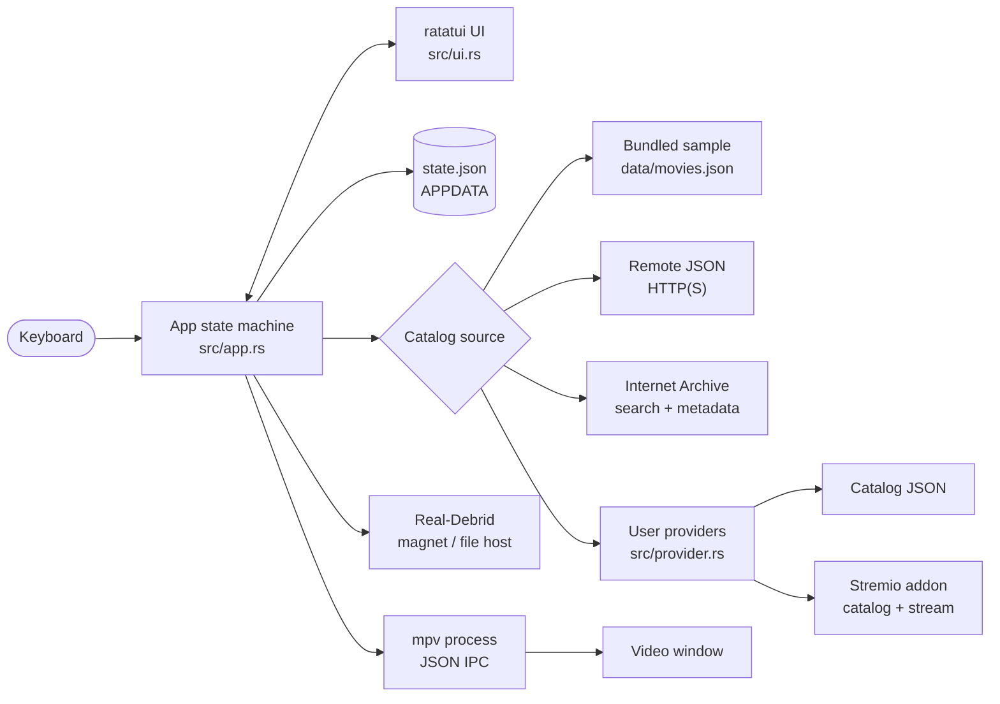
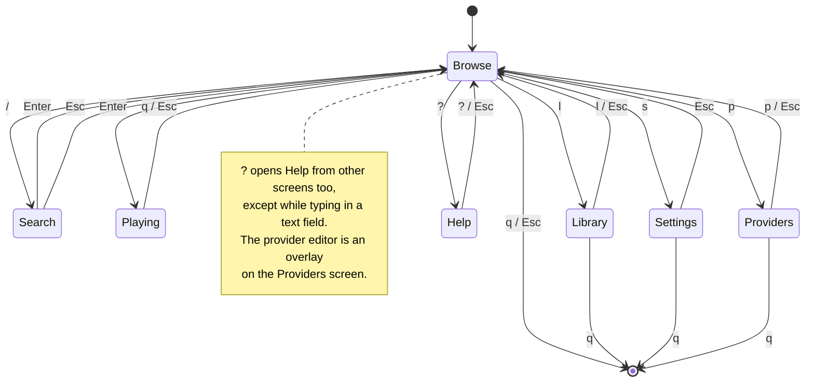

# russ-tui

<p align="center">
  <strong>A MovieBox-style media browser and streamer for your terminal.</strong><br>
  Built with Rust, <a href="https://ratatui.rs">ratatui</a>, <a href="https://github.com/crossterm-rs/crossterm">crossterm</a>, and <a href="https://mpv.io">mpv</a>.
</p>

<p align="center">
  <a href="https://www.rust-lang.org/"></a>
  <a href="LICENSE"></a>
  <a href="#requirements"></a>
</p>

Browse a catalog, search it, bookmark titles, resume where you left off, and
play streams in an external mpv window without leaving the keyboard. Bring your
own remote catalog or provider, or use the built-in Internet Archive source.

> **No provider URLs or piracy endpoints are bundled.** russ-tui contains only
> the consumer code. Every provider, catalog URL, and stream URL is supplied by
> you.

---

## Preview

```text
┌ Browse ──────────────────────────────────────────────────────────────────────┐
│ russ-tui - Bundled sample                                                    │
├──────────────────────────────────────┬───────────────────────────────────────┤
│ Catalog                              │ Details                               │
│                                      │                                       │
│ ▶  Inception (2010)  *8.8            │ Inception                             │
│    The Matrix (1999)  *8.7           │ Year: 2010   Rating: 8.8              │
│    Interstellar (2014)  *8.6         │ Genres: Sci-Fi, Drama, Adventure      │
│    Parasite (2019)  *8.6             │                                       │
│    Everything Everywhere All at Once │ A team of explorers travels through   │
│                                      │ a wormhole in an attempt to ensure    │
│                                      │ humanity's survival.                  │
│                                      │                                       │
│                                      │ ID: 3                                 │
│                                      │ ▶ Resume available at 12:34           │
├──────────────────────────────────────┴───────────────────────────────────────┤
│ up/down navigate   / search   enter play   b bookmark   l library             │
│ s settings   p providers   ? help   q quit                                   │
└──────────────────────────────────────────────────────────────────────────────┘
```

The TUI stays in the terminal. Video opens in its own mpv window; the terminal
shows progress, time, pause state, and volume, and sends playback commands over
mpv's JSON IPC.

---

## Features

- **Terminal-first browsing** with a split catalog/details layout, live search,
  bookmarks, watch history, and resume positions.
- **External mpv playback** with pause/resume, 10-second seeking, volume control,
  and automatic resume.
- **Four catalog sources**: bundled sample, remote JSON URL, Internet Archive
  public-domain films, and user-configured providers.
- **User providers** in two formats: catalog JSON (`{"items": [...]}` or a bare
  array) and Stremio addon manifests.
- **Real-Debrid integration** for magnet links and `debrid:`-prefixed file-host
  URLs. Plain HTTP(S) streams bypass it.
- **Local persistence** for volume, bookmarks, history, resume positions,
  catalog settings, Real-Debrid key, and providers.
- **Windows installer** that installs Rust, the MSVC C++ workload, and mpv when
  needed, builds a release binary, creates launchers, and configures the user
  environment.
- **No telemetry, no bundled providers, no media hosting.**

---

## Requirements

| Requirement | Notes |
| --- | --- |
| Rust stable | Edition 2024; Rust 1.85 or newer. The Windows installer handles this. |
| mpv | Needed for playback. The Windows installer installs `shinchiro.mpv` when needed. |
| C++ build tools | Required on Windows with the MSVC Rust host. The installer adds the Visual Studio C++ workload. |
| Network | Only for network-backed sources, providers, Real-Debrid, and streams. |

---

## Quick start

### Windows installer

Install directly from the web:

```powershell
irm https://raw.githubusercontent.com/russzw/russ-tui/main/install.ps1 | iex
```

Install and launch in one command:

```powershell
& ([scriptblock]::Create((irm https://raw.githubusercontent.com/russzw/russ-tui/main/install.ps1))) -Launch
```

Or clone and install:

```powershell
git clone https://github.com/russzw/russ-tui.git
cd russ-tui
powershell -ExecutionPolicy Bypass -File .\install.ps1 -Launch
```

The installer:

- Finds or downloads the source.
- Installs Rust via winget, with an official `rustup-init` fallback.
- Checks the Rust host and installs Visual Studio C++ Build Tools when the MSVC
  workload is missing.
- Installs mpv via winget when needed.
- Runs `cargo build --release --locked`.
- Installs to `%LOCALAPPDATA%\russ-tui`.
- Creates `russ-tui.cmd` and `russ-tui.ps1` launchers.
- Sets `RUSS_TUI_MPV` and optionally adds the install directory to your user
  `PATH`.
- Leaves your state in `%APPDATA%\russ-tui` untouched.

Run it later with:

```powershell
%LOCALAPPDATA%\russ-tui\russ-tui.cmd
```

Installer options:

| Option | Meaning |
| --- | --- |
| `-InstallDir <path>` | Use a custom install directory. |
| `-SkipRust` | Do not install Rust. |
| `-SkipMpv` | Do not install or configure mpv. |
| `-SkipBuildTools` | Do not install Visual Studio C++ Build Tools. |
| `-NoPath` | Do not modify the user `PATH`. |
| `-Launch` | Start russ-tui after installation. |
| `-SourceDir <path>` | Build from a specific checkout. |
| `-MpvPath <path>` | Use a specific `mpv.exe`. |

### From source

Windows:

```powershell
powershell -ExecutionPolicy Bypass -File .\run.ps1
```

Any platform with Cargo and mpv:

```sh
cargo run --release
```

Keep the repository root as the working directory when using the bundled
catalog, or use the installed launcher, which changes to the install directory
first.

### Linux and macOS

Install Rust and mpv with your package manager, then:

```sh
cargo run --release
```

mpv is discovered from `PATH`, `/usr/bin/mpv`, `/usr/local/bin/mpv`, and
`/opt/homebrew/bin/mpv`. Override it with `RUSS_TUI_MPV=/path/to/mpv`.

---

## Controls

Press `?` inside the app for the shortcut overlay. The full manual is in
[docs/GUIDE.md](docs/GUIDE.md).

### Browse

| Key | Action |
| --- | --- |
| `Up` / `Down`, `j` / `k` | Navigate |
| `/` | Search titles and genres |
| `Enter` | Play selected |
| `b` | Toggle bookmark |
| `l` | Library |
| `s` | Settings |
| `p` | Providers |
| `?` | Help |
| `q` / `Esc` | Quit |

### Playback

| Key | Action |
| --- | --- |
| `Space` | Pause / resume |
| `Left` / `Right` | Seek -/+ 10 seconds |
| `Up` / `Down` | Volume +/- 5% |
| `q` / `Esc` | Stop and return to Browse |

### Library

| Key | Action |
| --- | --- |
| `Up` / `Down`, `j` / `k` | Navigate watch history |
| `Enter` | Resume selected |
| `l` / `Esc` | Back to Browse |
| `q` | Quit |

### Settings

| Key | Action |
| --- | --- |
| `Up` / `Down` | Select field |
| `Left` / `Right` | Cycle source / adjust volume |
| `Enter` | Edit / save, or cycle source |
| `Esc` | Cancel edit / back |
| `q` | Quit |

### Providers

| Key | Action |
| --- | --- |
| `Up` / `Down` | Select provider |
| `a` | Add |
| `e` | Edit |
| `d` | Delete |
| `Enter` / `Space` | Enable / disable |
| `r` | Reload catalog |
| `Esc` / `p` | Back to Browse |
| `q` | Quit |

In the provider editor, `Tab` / `Up` / `Down` switches fields, `Enter` saves,
and `Esc` cancels.

---

## Catalog sources

Choose the source in **Settings -> Catalog source**. Changing it reloads the
catalog and clears the current search.

| Source | What it loads | Configure |
| --- | --- | --- |
| **Bundled sample** | `data/movies.json` beside the app or in the repo root. | Nothing. |
| **Remote URL** | Your HTTP(S) endpoint returning `{"items": [...]}`. | Set Catalog URL in Settings. |
| **Internet Archive** | Up to 60 popular public-domain feature films, resolved to MP4/WebM/MKV/OGV/AVI on play. | Nothing. No API key. |
| **My providers** | The merged catalogs of all enabled user providers. | Add providers with `p`. |

If a network source fails, russ-tui falls back to the bundled sample catalog and
shows a toast. Provider failures do not prevent other providers from loading.

---

## Providers

Providers are **entirely user-supplied**. russ-tui ships with no provider URLs
and no scraper endpoints. Open **Providers** with `p`, press `a`, and enter a
name plus one of these endpoint types.

### Catalog JSON

The URL returns either an object with an `items` array or a bare array. Only
`id` and `title` are required.

```json
{
  "items": [
    {
      "id": "my-movie-1",
      "title": "My Movie",
      "year": 2024,
      "rating": 8.5,
      "genres": ["Drama"],
      "overview": "A synopsis.",
      "poster_url": "https://example.com/poster.jpg",
      "stream_url": "https://example.com/movie.mp4"
    }
  ]
}
```

`stream_url` may be:

- An absolute `http://` or `https://` URL.
- A relative path, resolved against the provider catalog URL.
- A `magnet:` link, resolved through Real-Debrid.
- A `debrid:https://...` file-host link, resolved through Real-Debrid.
- An `archive:<identifier>` marker for Internet Archive.

Provider items are namespaced by provider URL so IDs cannot collide, and the
Details panel shows which provider supplied an item.

### Stremio addons

Enter the addon base URL or its `manifest.json`. russ-tui:

- Fetches every **movie** catalog that does not require an extra parameter.
- Deduplicates metadata across catalogs.
- Requests `{base}/stream/movie/{id}.json` on play.
- Prefers direct HTTP(S) stream URLs.
- Converts `infoHash`-only results to magnet links and uses Real-Debrid when a
  key is configured.

Series catalogs, required extras, addon subtitles, and quality selection are not
supported.

### Real-Debrid

Paste a key from <https://real-debrid.com/apitoken> into
**Settings -> Real-Debrid API key**. With a key configured:

- Magnet links go through `addMagnet -> selectFiles -> info -> unrestrict`.
- `debrid:` file-host links go through `unrestrict/link`.
- Plain HTTP(S) streams are played directly and never sent to Real-Debrid.

The key is stored in your local state file and masked on screen.

See [docs/GUIDE.md](docs/GUIDE.md#adding-providers) for the full provider
contract, stream forms, and Real-Debrid limitations.

---

## Architecture



A play request flows through a small resolution pipeline:

1. `Enter` queues the selected item.
2. Internet Archive and Stremio markers are resolved asynchronously.
3. Magnet and `debrid:` URLs are resolved through Real-Debrid when configured.
4. mpv receives `loadfile`, then seeks to the saved resume position.
5. Watch history is recorded and updated when playback ends.

---

## Screen map



---

## Project layout

```text
russ-tui/
├─ src/
│  ├─ main.rs       startup, event loop, catalog loading
│  ├─ app.rs        screen state, controls, playback orchestration
│  ├─ ui.rs         ratatui screens, overlays, help, toasts
│  ├─ media.rs      catalog model, search, file/HTTP loading
│  ├─ storage.rs    persisted state, bookmarks, history, providers
│  ├─ playback.rs   mpv discovery, JSON IPC, playback status
│  ├─ provider.rs   catalog JSON + Stremio provider support
│  ├─ archive.rs    Internet Archive search and stream resolution
│  └─ debrid.rs     Real-Debrid resolver
├─ data/
│  └─ movies.json   bundled demonstration catalog
├─ docs/
│  └─ GUIDE.md      full controls, provider, and setup manual
├─ install.ps1      Windows dependency installer and app installer
├─ run.ps1          build and launch from a source checkout
├─ Cargo.toml
├─ Cargo.lock
├─ LICENSE
└─ README.md
```

---

## Development

```sh
cargo build
cargo test
```

The Internet Archive integration has an opt-in live test:

```sh
cargo test live_archive_smoke -- --ignored --nocapture
```

Build the same release artifact the installer uses:

```sh
cargo build --release --locked
```

Tests cover catalog parsing, provider fetching and Stremio stream resolution,
Internet Archive parsing and file selection, Real-Debrid URL routing, storage
compatibility, keyboard behavior, and UI rendering.

---

## Troubleshooting

| Problem | Fix |
| --- | --- |
| `cargo` not found | Run `install.ps1` or install Rust from <https://rustup.rs>, then open a new terminal. |
| Linker errors on Windows | Install the Visual Studio **Desktop development with C++** workload. |
| Playback says mpv is missing | Install mpv, or set `RUSS_TUI_MPV` to the full path of `mpv.exe`. |
| Provider fails | Check the URL, JSON shape, timeout, and whether a Stremio addon exposes a usable movie catalog. |
| Remote catalog falls back | The endpoint must return `{"items": [...]}` with HTTP 2xx; stream URLs should be absolute. |
| Magnet playback fails | Set a Real-Debrid key and confirm the account is active and the torrent is available. |

More detailed fixes are in [docs/GUIDE.md](docs/GUIDE.md#troubleshooting).

---

## Privacy, content, and license

- No telemetry and no analytics.
- No provider URLs, scrapers, or piracy endpoints are bundled.
- Provider URLs and the Real-Debrid key are stored in plain text in your local
  state file. Protect that file.
- russ-tui does not host or index media. You are responsible for the content
  you access and for complying with the terms of any provider or service you
  configure.
- The bundled catalog is a demonstration. Some entries use public sample clips;
  others have no stream.
- Real-Debrid and Stremio addons are third-party services and are not affiliated
  with this project.

Released under the [MIT License](LICENSE). The software is provided **as is**,
without warranty of any kind.

---

<p align="center">
  <sub>Built for the keyboard. Bring your own catalog.</sub>
</p>
